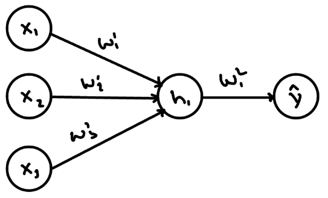
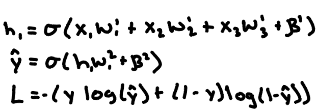
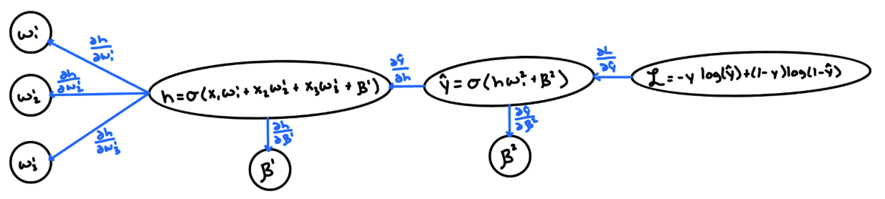
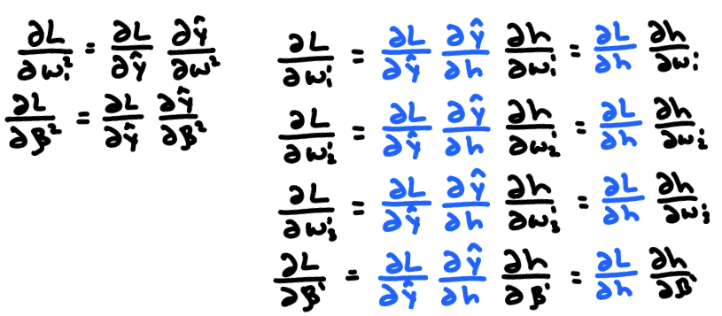
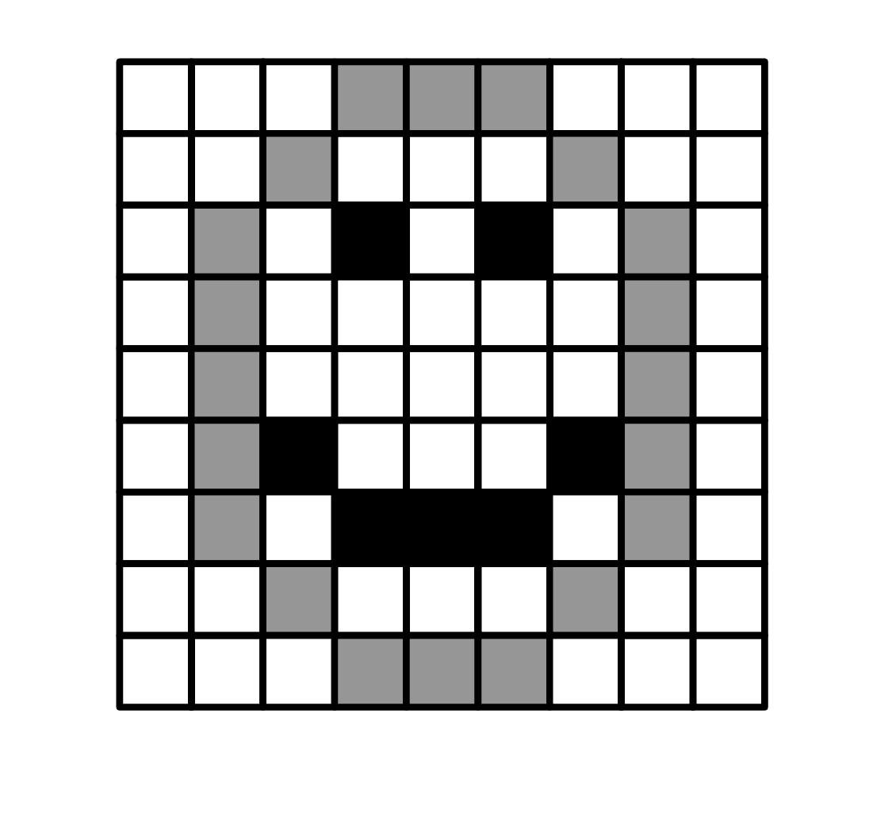
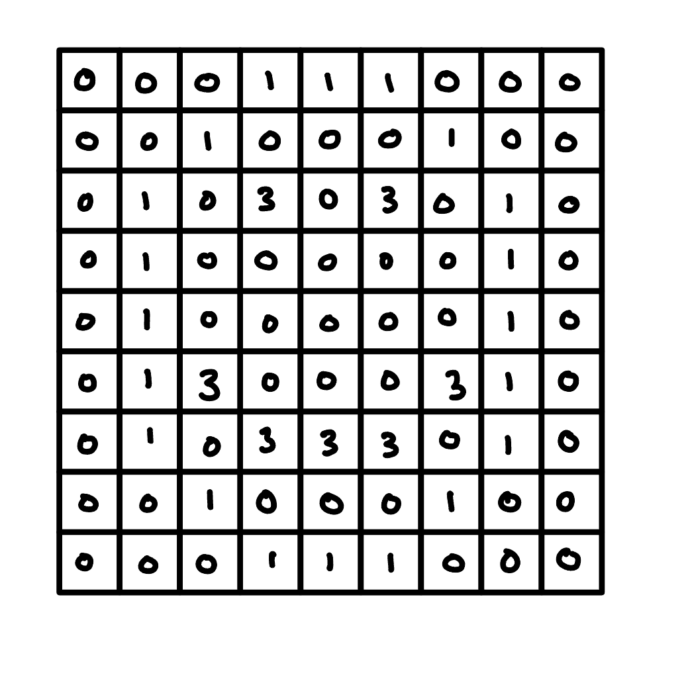
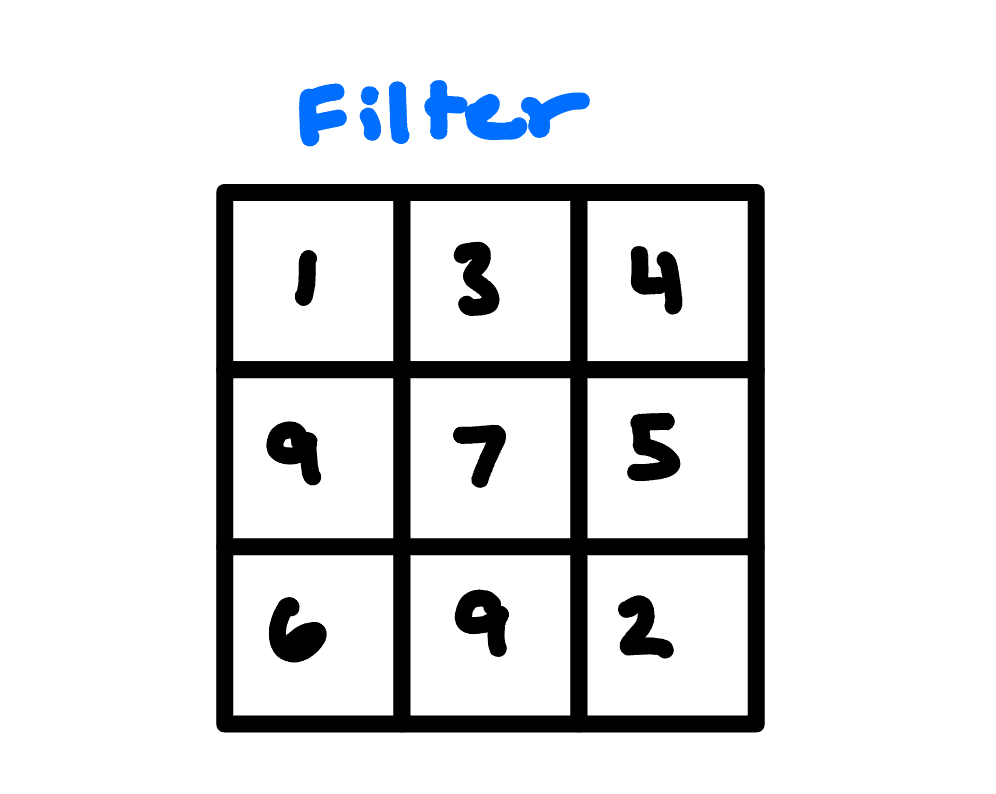
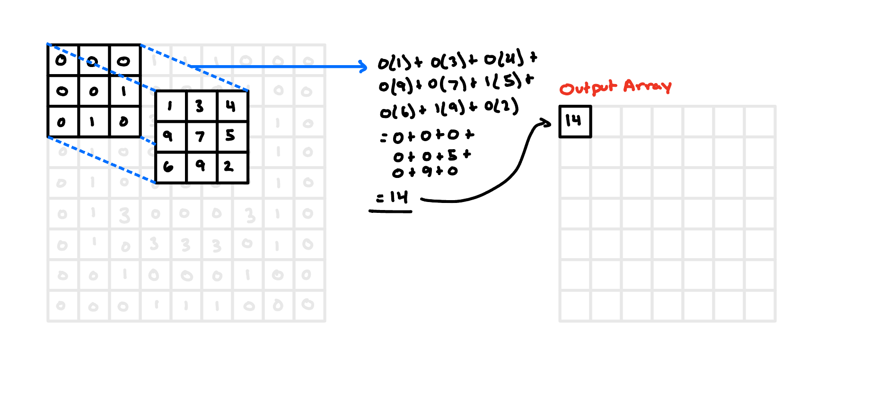
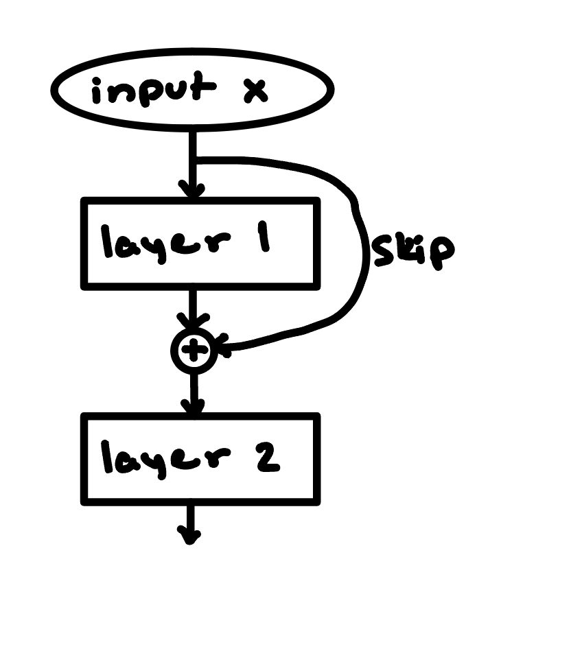

# Chapter 0 Review

## Tensors, Einops, and Einsum
This section is going to be super brief, and I’m not really going to explicitly walk through any of this. Instead, as is kind of the theme of this entire program, I think it’s best to just learn by doing.

[What’s a Tensor?](https://youtu.be/f5liqUk0ZTw?si=-O-IfwKzWuSGwbt5) is an OG video from physicist/professor Dan Fleisch and can help you build some stronger intuitions around what they are and how they work. Tensors are the fundamental building block of all neural networks, so it’s important that we get comfortable with them. I’m no mathematician, but I basically just think of tensors as higher-dimensional matrices. Basically, they’re just these arrangements of numbers that either represent information itself or how to manipulate information that’s passing through the network. 

[Einops](https://einops.rocks/) and [einsum](https://einops.rocks/api/einsum/) are these awesome ways we can tell a neural network to do this. It can be kind of counterintuitive at first, but then, after repeated work with them, they can become really intuitive. With good naming practices, it can make it both way faster/easier to write the code out and for someone else to read and understand it. 

I’d highly recommend really sitting with [all](https://einops.rocks/1-einops-basics/) [of](https://medium.com/@hunter-j-phillips/a-simple-introduction-to-broadcasting-db8e581368b3) [these](https://www.youtube.com/watch?v=pkVwUVEHmfI) [materials](https://rockt.ai/2018/04/30/einsum) and putting effort into the explicit einops practice problems. The intuitions with it will then really solidify through section 1.1 when we actually build transformers.

## Backpropagation
I’m assuming a basic level of background knowledge, but here’s a toy refresher on backprop. 

Backprop is the process by which the network actually comes to do anything useful. It’s the information on which the optimizer then decides how to actually update the parameters. On a super high level, we’re calculating how bad the model’s prediction was for a task and how we should tweak each of the parameters so that its prediction is a little bit better next time. 

So what is backpropagation, really? Fundamentally, it’s taking the partial derivative of the loss function with respect to every single weight and bias in the network, i.e. figuring out how much tweaking a given parameter contributes to how bad our prediction was. You can imagine how many calculations this consists of in a modern-day LLM…

But, as we know from multivariable calculus, we can take advantage of the [chain rule](https://en.wikipedia.org/wiki/Chain_rule) and re-use many of the common upstream partial derivatives. For instance, say we have a simple multi-layer perceptron (MLP):

Where

In this network, we need to find the partial derivative with respect to each of the four weights and two biases. PyTorch does this by building a computational graph to keep track of all of the network's trainable parameters and the route by which we get from them to the loss function:

Here, we can observe that many edges are used for multiple paths from the loss function to a given parameter. Instead of recalculating each time we traverse the graph, we store these local partial derivatives for reuse. With the chain rule, the partials with respect to each of the first layer’s weights depend on the partial with respect to the node in the hidden layer. 

This is somewhat trivial in this example, but you can imagine how in a deep neural network, this can massively reduce the number of calculations, so long as we are careful and smart about tracking everything. One note: I’m ignoring some of the nuances that come with the shape of the tensors/matrices in each layer, but that’s somewhat besides the point. 

Luckily, some great engineers have basically automated this entire process for us, and we’ll basically never have to worry about this in practice. It is, however, important to make sure we still understand the underlying mechanism. 

The few 0.4 exercises for this week are just building out some of the backpropagation infrastructure/algorithms by hand. If you’ve built something like [micrograd](https://github.com/karpathy/micrograd) or are generally comfortable with backpropagation, feel free to skip these exercises. I will say, though, that while my above example might make backprop seem pretty simple, it can get messy sometimes with these multi-dimensional tensors, broadcasting, and topological nuances. Again, it’s not something we’ll have to be all too conscious of day-to-day, but I think these can still be a good exercise for anyone to just keep building your conceptual and abstract reasoning abilities and general comfort with everything.

## Optimization
Optimizers then tell us how we actually want to update the weights based on the information gathered from the backpropagation process. All of a model’s behavior is learned through this optimization process, so understanding the dynamics of this process is critical for safety. The process of optimization and the changes that occur from it are largely responsible for phenomena like [specification gaming](https://vkrakovna.wordpress.com/2018/04/02/specification-gaming-examples-in-ai/), [goal misgeneralization](https://arxiv.org/pdf/2105.14111), [sycophancy](https://arxiv.org/pdf/2310.13548), and even things like [emergent misalignment](https://arxiv.org/pdf/2502.17424).

Basically every optimizer and every part of training is using some form of gradient descent:

$$\theta_{t+1} = \theta_t - \eta \, \nabla_\theta L(\theta_t)$$

Plain gradient descent has some issues, though, such as:
- It can be forbiddenly expensive (have to do a full foward pass on the entire training set before each step)
- It can get stuck in non-optimal local minima, saddle points, or plateaus 
    - Alternatively, it can perpetually bounce around one of these and never settle
- It can be instable and lead to exploding or vanishing gradients
- It's update steps can be too large or too small depending on where in training it is and what parameters it's updating
- It has a proclivity to overfit to the training data

Below, we'll walk through some common alternative optimization algorithms that sough to address these issues.

**Mini-batch stochastic gradient descent** estimates the gradient on a random batch of examples, making each update step much cheaper and faster. This process brings in noise, but this noise is actually useful because it can help the optimizer escape local minima, saddle points, and plateaus.

**Momentum** then kind of brings this to the next level. The idea here is to keep a running velocity of the past gradients and integrate this into the update calculation. It's almost literally like momentum in physics. It keeps it going in the direction it was already going. It carries the optimizer across small bumps or flat regions of the loss landscape, prevents it from getting too sidetracked by really steep gradients that are off-course, and takes it down a smoother, typically faster path towards the minima.

$$b_t = \mu b_{t-1} + g_t, \qquad \theta_t = \theta_{t-1} - \eta \, b_t$$

**Adaptive step sizes (AdaGrad, RMSprop)** divide each parameter's step by the size of its recent gradients, that way ones with large or noisy gradients take smaller steps and those with small gradients take larger ones. 

$$v_t = \alpha v_{t-1} + (1-\alpha) g_t^2, \qquad \theta_t = \theta_{t-1} - \eta \, \frac{g_t}{\sqrt{v_t} + \epsilon}$$

**Adam** combines the idea of momentum and adaptive step sizes into a single optimization algorithm. 

$$m_t = \beta_1 m_{t-1} + (1-\beta_1) g_t, \quad v_t = \beta_2 v_{t-1} + (1-\beta_2) g_t^2, \quad \theta_t = \theta_{t-1} - \eta \, \frac{m_t / (1-\beta_1^t)}{\sqrt{v_t / (1-\beta_2^t)} + \epsilon}$$

(The math here isn't super important, just focus on the concepts)

**AdamW** then seeks to learn more generalizable weights by adding *weight decay* directly to the weights, shrinking them towards zero to prevent overfitting and prefer simpler solutions where possible. AdamW is the default optimizer used with most transformer architectures.

We might also choose to "clip" gradients above a predetermined limit to stop a single bad or non-representative batch from influencing too much. We'll also use normalization techniques like BatchNorm or LayerNorm, but we'll get into those later. 

There are also a number of hyperparamters we'll need to "tune," each of which can have massive effects on our training. The **learning rate** is a particularly important one. Too high a learning rate and our loss will never converge, too low and learning can stall (or just take a long ass time). We'll often first **warmup** our learning rate by starting it near 0 and raising it linearlly over the first few steps. We do this because our weights are initialized randomly and full-sized steps can be destabilizing. We'll also often use a **learning rate scheduler** to dynamically change the learning rate over the course of training to take large steps early on during training to make fast progress and incrementally smaller steps over time to help the optimizer settle into a nice minimum. 

## Convolutional Neural Networks
It's often easiest to start with CNNs for image recognition, and here, we'll start with a small black and white 9x9 pixel image.

Computationally, we know each pixel of the image is represented by a number  representing the intensity of the pixel along the black-white gradient. So, to the computer, it looks something more like:

We're assuming here, as in the picture, that there are only 3 different gradients of the color intensity. We then have something called a **filter** (also known as a **kernel**) which is a small grid of weights (parameters). Let's say here that our filter is 3x3 and it is initialized randomly, like any other weights in a neural network:

A **convolution** then is this mathematical process in which we slide our filter over "patches" of our original image, in this case 3x3 pixels at a time. The output is the sum-product of the filter weights and the patch values.

We'll then do this for each patch of our input image, resulting in a 3x3 output array of this convolutonal layer. Notice here that the output layer is of a lower dimensionality than the input layer (just 49 numbers versus the original 81).

What ends up happening with this is that our network, over time, is learning important relational information about the pixels being procesed together. This is known as  locality. 

It can get a bit more complex with more input channels (like with color images in RGB) and more convolutional layers, but we'll skip that for this. The important point to take away from CNNs is that it is a way that a neural network is able to process a given piece of information along with its surrounding *context*. The reason why CNNs are included here is because they were, in a way, a precursor for and form the intuitive basis for processing multiple tokens at a time in natural language processing. 

Some quick definitions of CNN concepts:
- **Kernel size:** refers to both the size of the filter/kernel and the size of a patch
- **Stride:** how far the kernel moves each step. Sometimes, we we'll want to slide more than just 1 pixel over.
- **Padding:** sometimes we'll want to add zeros to the edges of the input (often if we want to emphasize learning more info around the edges).
- **Channels:** refer to the number of separate filters. For example, when we process an RGB image, we'll have 3 separate numbers for each pixel (224, 196, 181) to denote the pixel's intensity along each of the red, green, and blue spectrums (instead of just the black-white spectrum as earlier). Each of these numbers sits on its own 9x9 array. We'll need 3 separate kernels to process each of these different channels.
- **Pooling:** a common downsampling technique in CNNs used to reduce the dimenionality across a given dimension while retaining whatever relevant information we want (max pooling, mean pooling, global pooling). Pooling can also help the model learn more generalizable image recognition jobs and reduce overfitting.

## Residual Networks
In theory, a deeper network just simply has far more repesentational power than a shallow network. But the problem was that deep networks are super suseptible to exploding and vanishing gradients. They also put the input data through so many transformations that information can easily get lost or just become too unrecognizable as it goes through the network. 

The fix to this was to add **residual (or skip) connections**. In a simple feed-forward network, a given layer operates only on the outputs of the previous layer. Skip connections instead add back in information from an earlier position into the input fed to our layer.

The has the effect of making training much more stable, preventing vanishing/exploding gradients, and making deep networks real good. Skip connections are the direct ancestor of the ***residual stream***, one of the most important aspects of the transformer architecture and our main object of study in much of Chapter 1 (and mechinterp in general). 

