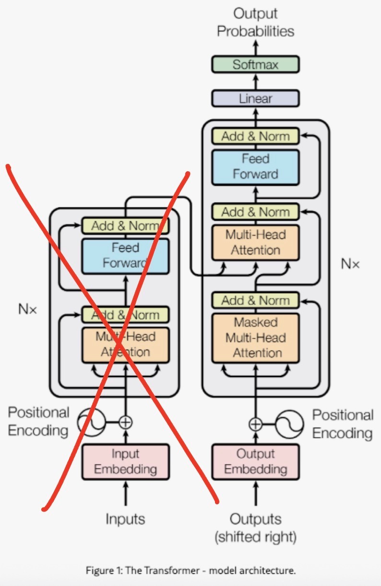
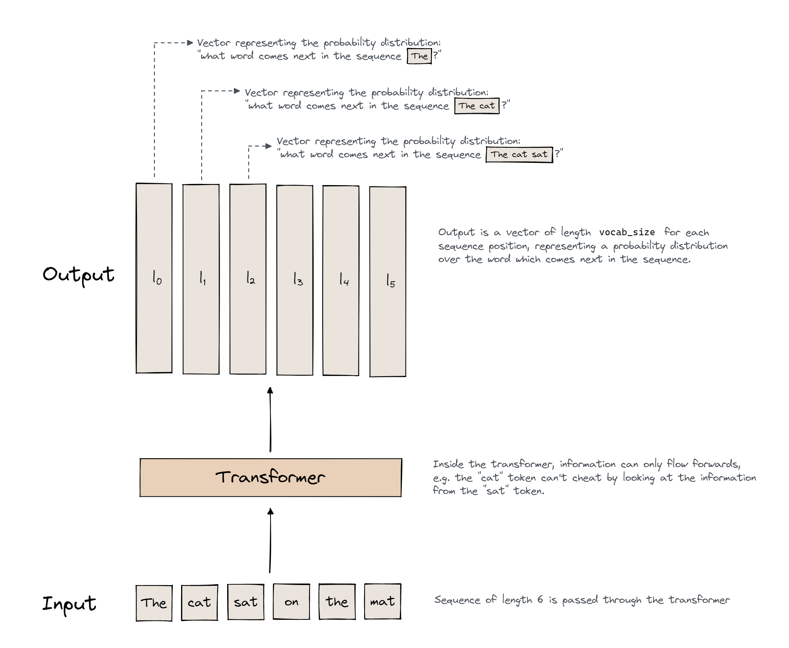
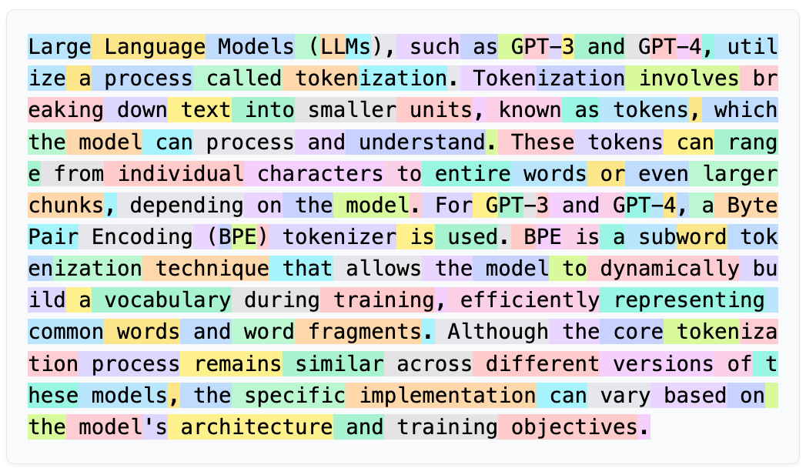
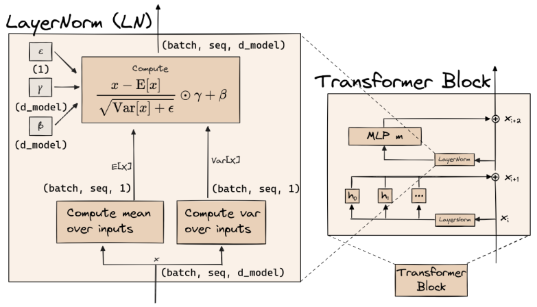
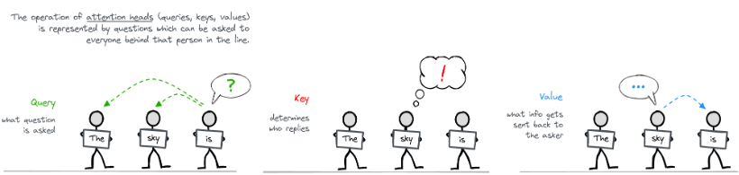
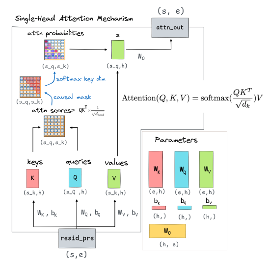
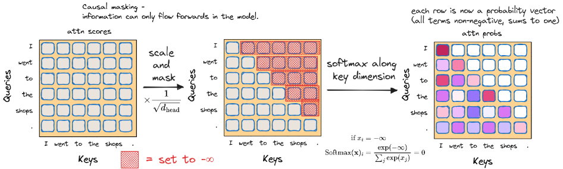
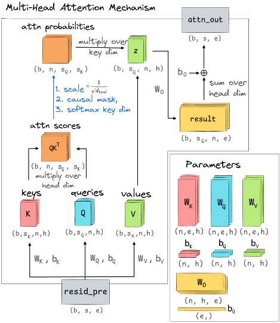
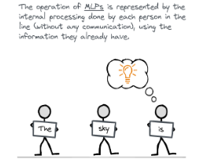
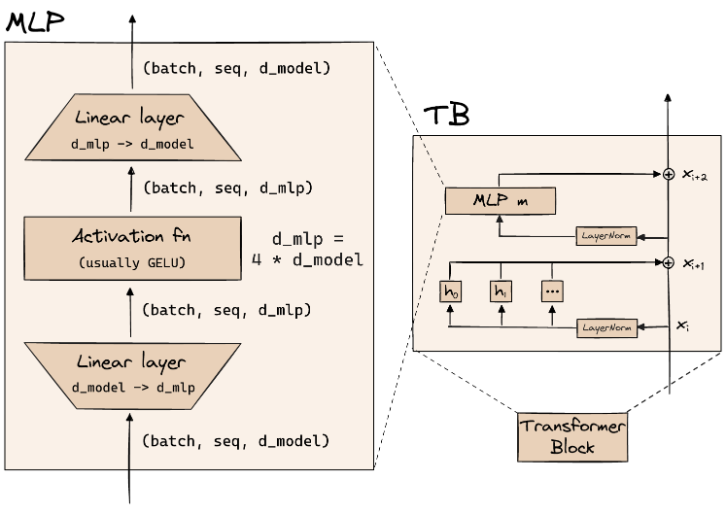

Build and train GPT-2 from scratch, from tokenization and attention through to sampling text.

## This week's exercises

| Section | Exercise | Importance | Time |
| --- | --- | --- | --- |
| 1.1 | `LayerNorm` | 3/5 | 15 min |
| 1.1 | `Embed` | 3/5 | 10 min |
| 1.1 | `PosEmbed` | 3/5 | 15 min |
| 1.1 | `apply_causal_mask` | 5/5 | 15 min |
| 1.1 | `Attention` | 5/5 | 45 min |
| 1.1 | `MLP` | 4/5 | 15 min |
| 1.1 | `TransformerBlock` | 3/5 | 15 min |
| 1.1 | `Unembed` | 3/5 | 10 min |
| 1.1 | `DemoTransformer` | 3/5 | 15 min |
| 1.1 | write training loop | 4/5 | 20 min |
| 1.1 | `sample` | 3/5 | 40 min |

**Note: the training run itself takes extra time, so use a GPU (e.g., Colab)**. If you want some RunPod comute credits to use a different GPU, reach out to me. 

This is about 3.5 hours of estimated coding work. I'd highly recommend reviewing the notes below/reading through the notebook in earnest and making sure you're actually understanding things. 

If you have time and want to do more, my top recommendation would be the KV-caching exercise, then the rest of the sampling stuff. 

## Background and Overview
In 2017, researchers at Google made a breakthrough in machine translation with the (now canonical) paper [Attention Is All You Need](https://proceedings.neurips.cc/paper_files/paper/2017/file/3f5ee243547dee91fbd053c1c4a845aa-Paper.pdf). Long story short, they mushed together a bunch of stuff that had been building up over the past couple decades into a new network architecture called the transformer that would prove to change the trajectory of language modeling and machine learning in general. 

We saw some of these things last week with CNNs and residual networks. Today, we build off of these ideas and explore the full structure of the transformer. Notably, the version of the transformer from this paper is a little different from what we'll be building. It's what's called an [encoder-decoder model](https://www.ibm.com/think/topics/encoder-decoder-model), but most of today's LLMs, including GPT-2 (what we're building), are decoder-only models.

Some other changes, which we'll get into more below, are that GPT-2-like models don't have what's called cross-attention (because there's no encoder to do cross-attention with), do the normalization step *before* each sublayer, positional embeddings are trained/learned, and use [GELU](https://docs.pytorch.org/docs/stable/generated/torch.nn.GELU.html) instead of [ReLU](https://docs.pytorch.org/docs/stable/generated/torch.nn.ReLU.html) (which, for all intents and purposes, are basically the same thing).

Here's a high-level overview of what's going on. We start with an input sequence of text. This text first gets turned into tokens which are fed into our transformer, where these tokens get manipulated this way and that, over and over and all in parallel until eventually some stuff comes out the other end: probability distributions over our model's vocabulary representing what it thinks the next token should be given the tokens that have come through up to this point.

Going a step deeper, here is the rough path by which a sentence flows through a transformer:
- Before going into the transformer, the string of text is fed into a tokenizer which converts the string of words into a list of tokens, each represented by a single scalar number, the **token ID**, which corresponds to a particular token in our **vocabulary**. So, we now have a list of tokens/token IDs. 
- This list of token IDs is then embedded (i.e. linearly transformed) via our **embedding and positional embedding matrices**, to then represent each token in our sequence by a vector (one vector for each token).
- The embedding and positional embedding vectors are then added together to form a single vector representation of each token in our sequence.
- These representations then begin floating down the model's **residual stream**.
- Next, we arrive at the first **transformer block**. Here, a copy of each of our representations gets fed into the transformer block, while another copy keeps floating down the residual stream. 
- Inside the block, 
  - Each token's vector is first **layer-normalized**. 
  - Then, they enter the attention block/sub-layer in which the representations are fed into each **attention head**. 
  - In each head,
    - Each representation is transformed into a **key, query, and value vector**, which are of a lower dimensionality than the residual stream vectors. 
    - **Attention scores** are calculated over the keys and queries.
    - A **causal mask** is applied to ensure we can't cheat by looking ahead to future tokens in the sequence. 
    - These masked attention scores are then turned into **attention probabilities** using the **softmax** function, which is then multiplied against the value vectors.
    - The result is projected back up to residual stream dimensionality using an **output matrix**.
  - The outputs of each individual head are then summed together and added to the residual stream. So, our residual stream now contains these altered vectors that carry some information from the original embeddings + whatever was going on inside each of the attention heads. 
  - One copy of these altered representations keeps floating down the stream while another comes back into the transformer block. Here, it's layer-normalized *again* and fed into a simple feed-forward network (MLP), where
    - Each vector is projected up to a higher dimensional space and goes into an activation function.
    - They're then projected back down to the residual stream dimensionality and added to the residual stream.
- This process is then repeated for however many transformer blocks we have in our network.
- After all the transformer blocks, we do one final layernorm and multiply our vectors by an **unembedding matrix**, which, based on everything our model has done up to this point, gives us "scores" for each possible token to come next (each token in our vocabulary). These scores are called **logits**.
- We then apply the softmax function to the logits, which turns the "raw" scores into a probability distribution over the vocabulary.
- When generating text, we then finally sample from the distribution at the last position to get the next token.

## Tokenization

This pretty much sums it up for our purposes. A tokenizer breaks up a string into tokens, each of which corresponds to a unique integer **token ID**. These token IDs are what's then actually fed into our transformer.

GPT-2 uses BPE, and the nuances of the algorithm aren't super important here. If you want to learn more, you can check out [this](https://huggingface.co/learn/llm-course/en/chapter6/5) explainer from HuggingFace. 

[Here's](https://tiktokenizer.vercel.app/?model=gpt2) a fun tokenizer interface to play with and build some intuitions around. This demo uses the GPT-2 tokenizer. You can also check out [Karpathy's video](https://www.youtube.com/watch?v=zduSFxRajkE) on building a tokenizer from scratch, if you're so inclined. 

## Embeddings
So, we put our input text into the tokenizer and get a list of token IDs, great! But a word being represented by just a single number doesn't offer us much in the way of syntax or semantics, both of which are incredibly important for modeling language (well). To get a more complex representation that *does* carry these properties, we convert our scalar token IDs into what are called [word](https://www.ibm.com/think/topics/word-embeddings) [embeddings](https://rcpedia.stanford.edu/blog/2020/03/04/word-embeddings/).

Word embeddings are vector representations of words (tokens). They carry a lot of semantic information and syntactic properties that are extremely important for language. We don't have a ton of time to get into how embeddings actually work, but there are some additional resources linked at the bottom of this post if you're keen to learn more.

Ok, so how do we actually do this? For a sentence of length $d\_sequence$, we have a list of token IDs that are fed into our transformer:

$$(id_1, ..., id_{(d\_sequence)})$$

These IDs are first converted into one-hot representations, which are typically denoted as standard-basis vectors $e_t \in \mathbb{R}^{(d\_vocab)}$, where the element at index $t$ is $1$ (counting from $0$) and all others entries are $0$.

These don't really have any additional representational capacity than our scalar token IDs, but they allow us to index into our embedding matrix using linear algebra.

Let's take an example. The GPT-2 tokenizer's ID for the token "` monkey`" is $21657$. The one-hot representation of monkey is then $e_{21657}$, which is a vector with a $1$ in the $21658$-th entry (starts at 0) and $0$'s everywhere else.

So, after we get our one-hot representations of every token in our sequence, we have a $d\_sequence$ number of $d\_vocab$-dimensional vectors. We stack these together, creating our first **tensor**, $E$!

$$(e_{id_1}, ..., e_{id_{(d\_sequence)}}) = E \in \mathbb{R}^{(d\_sequence \times d\_vocab)}$$

Each row in our tensor $E$ corresponds to the one-hot representation of a given token in our sequence. 

We can then use this tensor to transform these one-hot encodings into their corresponding word embeddings. 

We have an embedding matrix

$$W_E \in \mathbb{R}^{(d\_vocab \times d\_model)}$$

Each row of this matrix contains the $d\_model$-dimensional vector (our word embeddings) for each word (token) in our $d\_vocab$-length vocabulary.

***One quick note:** you'll notice that in the code, we actually just index directly into this matrix using `W_E[tokens]`, so this one-hot framing is more conceptual to show how things are done mathematically...*

Anyways, we take our one-hot encodings and index into our embedding matrix:

$$X_E = EW_E \in \mathbb{R}^{(d\_sequence \times d\_model)}$$

So, we now have a tensor $X_E$ containing $d\_model$-dimensional word embeddings for each of our tokens in $d\_sequence$!

## Positional Embeddings
But wait—these word embeddings might carry super important information about the tokens, but the order in which these tokens come through matters a lot. As of now, with just the word embeddings $X_E$, the two sentences

> I often wish I had a pet monkey

> often I monkey a had pet I 

Because of the causal mask, the model can still infer *some* position information (for example, how many tokens come before), but this is weak and indirect. **Positional embeddings** provide each position its own explicit signal.

Our positional embedding follows much of the same process as the word embedding, but we instead index into our positional embedding matrix by each token's **position** in the sequence, not by its token ID. So here, we have another set of standard basis vectors $e_i \in \mathbb{R}^{max\_context}$, a one-hot encoding for each token position, up to some max context length (in the case of GPT-2, 1024).

With this, no matter the sentence, the 3rd token in a sequence always gets the same positional embedding. For our sentence, we then have the matrix $P$ such that:

$$(e_{1}, ..., e_{d\_sequence}) = P \in \mathbb{R}^{(d\_sequence \times max\_context)}$$

Similar to before, we have our positional embedding matrix

$$W_P \in \mathbb{R}^{(max\_context \times d\_model)}$$

Which has a learned row for each position up to the max context length. But, a sequence of length $d\_sequence$, like ours, uses only the first $d\_sequence$ rows.

And again we index into this matrix using our one-hot positional encodings

$$X_P = PW_P \in \mathbb{R}^{(d\_sequence \times d\_model)}$$

## The Residual Stream 
Putting these together, we get the start of our residual stream:

$$X^{(0)} = X_E + X_P = EW_E + PW_P \in \mathbb{R}^{(d\_sequence \times d\_model)}$$

We write $X^{(0)}$ for the embeddings before they enter the first transformer layer. $X^{(l)}$ then represents the residual stream *after* block $l$. Block $l$ reads $X^{(l-1)}$ and writes $X^{(l)}$. 

We can think of each token in our sequence as having its "own" residual stream (which will come in handy later when we talk about attention). But, we'll generally represent these all together as above.

Each layer from here will read a copy from the stream(s) and write its output back.

## LayerNorm

GPT-2 (and most transformers today) do pre-layer normalization, rather than post- like the original Attention Is All You Need paper. The reasoning behind this is basically that empirically it's been shown to enable stabler training and creates a "cleaner" residual stream, allowing us to treat it as this linear and additive communication channel between layers, in which it also happens to be (theoretically) easier to trace and attribute particular contributions to particular places.

The main alternative to layer normalization is batch normalization. As the names suggest, the key difference is the axis over which we're normalizing: LayerNorm normalizes each token's vector across its $d\_model$ features, while BatchNorm normalizes each feature across the batch (and sequence positions). The nuances here aren't that important, and the moral of the story is that empirically LayerNorm just works better, and that's why we use it. If I were to mention one thing, it's that LayerNorm keeps positions independent, and BatchNorm can leak information between token positions in a way that might interfere with our causal mask and the process of autoregressive sampling. 

Back to the equation: for a particular token's residual stream vector, we're subtracting the mean across its $d\_model$ features, dividing by the standard deviation (technically the square root of the variance plus a tiny epsilon term to ensure we never divide by zero and break our model). We then apply a learned scale parameter and add a bias term. 

As with many other things, PyTorch has a handy `torch.nn.LayerNorm` module for us (though the exercises actually have you implement it yourself).

## Attention

As we're all aware, attention is the crux of the transformer architecture—both in terms of what it's able to accomplish and in terms of difficulty in understanding...

### Single-Head Attention

We'll start by thinking through what attention looks like in a single attention head. First, let's recall the shape of what we're processing. We have our (normalized) residual stream coming into our attention head:

$$X^{(l-1)} \in \mathbb{R}^{(d\_sequence \times d\_model)}$$

Which we can think of as $d\_sequence$ vectors $x^{(l-1)}_i \in \mathbb{R}^{(d\_model)}$ stacked together.

In a given attention head, we have three weight matrices $W_Q, W_K, W_V \in \mathbb{R}^{(d\_model \times d\_head)}$ and their corresponding bias vectors $b_Q, b_K, b_V \in \mathbb{R}^{(d\_head)}$, which we use to derive each token's query, key, and value *vectors*:

$$q_i = x^{(l-1)}_iW_Q + b_Q \in \mathbb{R}^{(d\_head)}$$

$$k_i = x^{(l-1)}_iW_K + b_K \in \mathbb{R}^{(d\_head)}$$

$$v_i = x^{(l-1)}_iW_V + b_V \in \mathbb{R}^{(d\_head)}$$

Using the queries and keys, we then calculate **attention scores** for every (query, key) combo:

$$s_{m,n} = q_mk_n^\top \times \frac{1}{\sqrt{(d\_head)}}$$

For some $m,n \in \{1, ..., d\_sequence\}$. 

We do this $\forall \space m,n$ to get a matrix of attention scores, because, remember the entire sequence is going through the attention head at once. So across the whole sequence, we have the query, key, and value matrices

$$Q = X^{(l-1)}W_Q + b_Q \in \mathbb{R}^{(d\_sequence \times d\_head)}$$

$$K = X^{(l-1)}W_K + b_K \in \mathbb{R}^{(d\_sequence \times d\_head)}$$

$$V = X^{(l-1)}W_V + b_V \in \mathbb{R}^{(d\_sequence \times d\_head)}$$

$$S = \frac{QK^\top}{\sqrt{d\_head}} \in \mathbb{R}^{(d\_sequence \times d\_sequence)}$$

We can think of each attention score representing the compatibility between a given query and key, i.e. how well token n's key matches token m's query (its "question"). We divide by the square root of the head's dimensionality just to keep the scores in a range that doesn't saturate the softmax that follows. 

But notice, there's an issue with this: when $n > m$, a token's query is being answered by a token that comes after it. That's a big no-no! If we let this happen, then the model would just learn something super trivial like "ask the token in the next position what it is and then just put all of the probability mass onto that token in the vocab for our prediction," get perfect accuracy on its training data, and be utterly useless.

To fix this, we add a **causal mask** to our score matrix, where we set the score to $-\infty$ for every (query, key) pair where the key has a higher index than the query. After the softmax, these pairs get a weight of exactly $0$.

As shown in the image, we then softmax over the key dimension, where each row becomes a probability vector over which we basically get weights for how much a given token should "attend to" the other tokens that have come before it. This pattern of weights is known as the "attention pattern." So, we now have a lower-triangular matrix 

$$A = softmax(mask(S)) \in \mathbb{R}^{(d\_sequence \times d\_sequence)}$$

We then multiply our attention pattern by our value vectors, which we recall are $d\_sequence$ stacked $d\_head$ vectors. 

$$Z = AV \in \mathbb{R}^{(d\_sequence \times d\_head)}$$

Here each token's output is a weighted sum of the value vectors of the tokens it attends to. We then project back out using $W_O \in \mathbb{R}^{(d\_head \times d\_model)}$ to the residual stream's dimensionality:

$$O = ZW_O + b_O = AVW_O + b_O \in \mathbb{R}^{(d\_sequence \times d\_model)}$$

(With more than one head, $b_O$ is added only once, after the heads' outputs are summed.)

**QK and OV Circuits**: People often think of an attention head as having two "circuits." The QK circuit, $W_Q W_K^\top$, uses the query and key tokens to decide the attention pattern (where to attend). The OV circuit, $W_V W_O$, decides what information is moved from an attended token into the residual stream. The two circuits act independently: the attention pattern comes *only* from QK, and OV is the linear map applied to the tokens that are attended to. Both are $[d\_model \times d\_model]$ matrices with max rank $d\_head$.

### Multi-Head Attention

As we know, each attention layer consists of multiple attention heads. Specifically, we have $n\_heads$ heads, each with its own $W_Q, W_K, W_V, W_O$ matrices and its own attention pattern. Each head runs independently, and their outputs are summed and added to the residual stream. Usually, $d\_head = \frac{d\_model}{n\_heads}$.

As you'll see in the exercises, in code, we compute all heads, all positions, and all batch examples at once, which is why the tensors get constructed in all of these extra dimensions.

As is the common theme of this program, the best way to wrap your head around this is to just do it! I'd also recommend just staring at this diagram for a bit to try to wrap your head around the dimensionality of everything. This is somewhere where Einops is REALLY helpful.

Basically, we have 

$$X^{(l-1)} \in \mathbb{R}^{[batch\_size \space \times \space d\_seq \space \times \space d\_model]}$$

$$W_Q, W_K, W_V \in \mathbb{R}^{[n\_heads \space \times \space d\_model \space \times \space d\_head]}$$

$$b_Q, b_K, b_V \in \mathbb{R}^{[n\_heads \space \times \space d\_head]}$$

Through which we obtain the queries, keys, and values for every token in a sequence across every example in the batch for every attention head in the layer. But notice, given the dimensionality of these tensors, we can't just multiply things like we have been. We have to be broadcasting across and reducing over particular dimensions to get out the shapes that we want. For instance, 

$$Q, K, V \in \mathbb{R}^{[batch\_size \space \times \space d\_seq \space \times \space n\_heads \space \times \space d\_head]}$$

And we see that something like $X^{(l-1)}W_Q$ is an invalid tensor multiplication. We can't in our code just do something like `Q = X @ W_Q`. 

So how do we do this? That's for you to figure out as you're building your transformer...

Regardless, we then write

$$\tilde{X}^{(l)} = X^{(l-1)} + \text{Attn}^{(l)}(\text{LN}(X^{(l-1)}))$$

As the residual stream after the attention sublayer of block $l$.

## Multi-Layer Perceptron (MLP)

Ok, now the MLP layer. Something a bit easier. Like with the attention layer, we need to take what's currently in our residual stream, layernorm it, and then feed that into our MLP. One critical thing about the MLP that differs from the attention layer is that the MLP acts on each token independently, and no information is shared between tokens here. 

Building up our intuitions with how this looks processing all examples in our batch, we can use the tensor $\tilde{X}^{(l)} \in \mathbb{R}^{[batch\_size \space \times \space d\_sequence \space \times \space d\_model]}$. This is the residual stream in the middle of layer $l$—after it has gone through the attention sublayer but not the MLP sublayer of the transformer block. 

This gets projected up to $d\_mlp$, some higher-dimensional space (in the case of GPT-2 $4 \times d\_model$), which has some added representational power. We have our up-projection matrix $W_{in} \in \mathbb{R}^{[d\_model \space \times \space d\_mlp]}$, which we apply to our residual stream to get our hidden, higher-dim representation:

$$H = \text{LN}(\tilde{X}^{(l)})\,W_{in} + b_{in} \in \mathbb{R}^{[batch\_size \space \times \space d\_sequence \space \times \space d\_mlp]}$$

We apply GELU for some non-linearity action, $GELU(H)$, then project back down with $W_{out} \in \mathbb{R}^{[d\_mlp \space \times \space d\_model]}$

$$X^{(l)} = \tilde{X}^{(l)} GELU(H)W_{out} + b_{out} \in \mathbb{R}^{[batch\_size \space \times \space d\_sequence \space \times \space d\_model]}$$

The MLP output is added back to the residual stream to give the output of block $l$.

## Output
Finally, we apply one last layernorm and unembed into logits over our vocabulary with our unembedding matrix $W_U \in \mathbb{R}^{(d\_model \times d\_vocab)}$ (and bias). We then softmax over the logits to get a probability distribution for the next token. So in sum, roughly speaking:

$output = softmax(layernorm(X^{(L)})W_U + b_U)$

One thing to note here is that GPT-2 ties $W_U$ to $W_E$, namely $W_U = W_E^\top$. There are pros and cons to this, but our implementation in these exercises actually *does not* do this. 

## Training Objective
Taking a quick step back, transformers are fundamentally next-token prediction machines. At each position $i$, the model is trying to predict token $i+1$. During training, we have the ground truth labels for this (i.e. in the sentence `"I often wish I had a pet monkey"`, the prediction at the position of `" wish"` is trying to predict the token `" I"`).

At position $i$, the model outputs a probability distribution over the vocabulary. Importantly, during training, the model isn't actually sampling from this distribution—it's just going to be trained to put as much weight as possible on the token `" I"`. The loss function we're calculating on this and trying to optimize for is cross-entropy (~negative log likelihood).

But in reality, we're doing this over all of the tokens in a sequence for every example in the batch all at once, calculating a batched cross-entropy loss.

## Further Resources

#### Transformers and Attention
1. [Transformer Explainer](https://poloclub.github.io/transformer-explainer/)
1. [ARENA Lecture on Transformers](https://youtu.be/11Z50mi8dSg?si=8fFq3aWCHDmXU6Ik)
1. [What is a Transformer?](https://www.youtube.com/watch?v=bOYE6E8JrtU&t=1s)
1. [Implementing GPT-2 From Scratch](https://youtu.be/dsjUDacBw8o?si=5W9cqvOKznmguPBX)
1. [A Mathematical Framework for Transformer Circuits](https://transformer-circuits.pub/2021/framework/index.html)
1. [A Walkthrough of A Mathematical Framework for Transformer Circuits](https://youtu.be/KV5gbOmHbjU?si=eK80cWcC-jgt2r0O)
1. [Language Models are Unsupervised Multitask Learners (GPT2 Paper)](https://cdn.openai.com/better-language-models/language_models_are_unsupervised_multitask_learners.pdf)
1. [Attention Is All You Need](https://proceedings.neurips.cc/paper_files/paper/2017/file/3f5ee243547dee91fbd053c1c4a845aa-Paper.pdf)
1. [The Annotated Transformer](https://nlp.seas.harvard.edu/2018/04/03/attention.html)
1. [Attention? Attention!](https://lilianweng.github.io/posts/2018-06-24-attention/)
1. [3Blue1Brown Attention in transformers](https://www.3blue1brown.com/lessons/attention/)

#### Word Embeddings
1. [Understanding and Creating Word Embeddings](https://programminghistorian.org/en/lessons/understanding-creating-word-embeddings)
1. [Efficient Estimation of Word Representations in Vector Space](https://arxiv.org/pdf/1301.3781)
1. [Text Embedding Models Contain Bias. Here's Why That Matters](https://developers.googleblog.com/text-embedding-models-contain-bias-heres-why-that-matters/)
1. [Word2Vec Tutorial - The Skip-Gram Model](https://mccormickml.com/2016/04/19/word2vec-tutorial-the-skip-gram-model/)
1. [Word2Vec Tutorial Part 2 - Negative Sampling](https://mccormickml.com/2017/01/11/word2vec-tutorial-part-2-negative-sampling/)