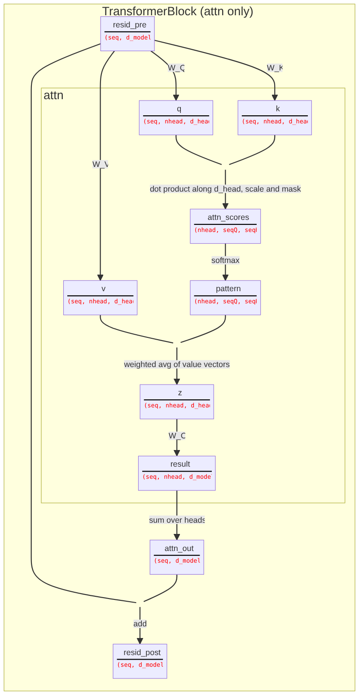
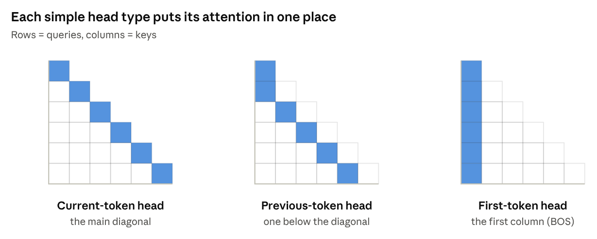
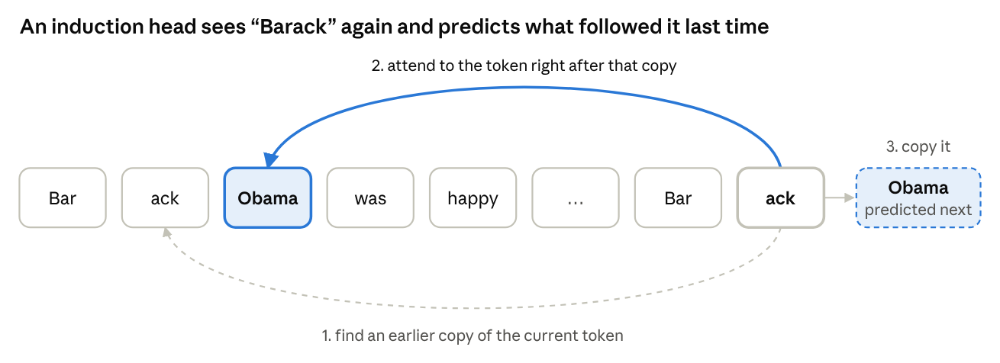
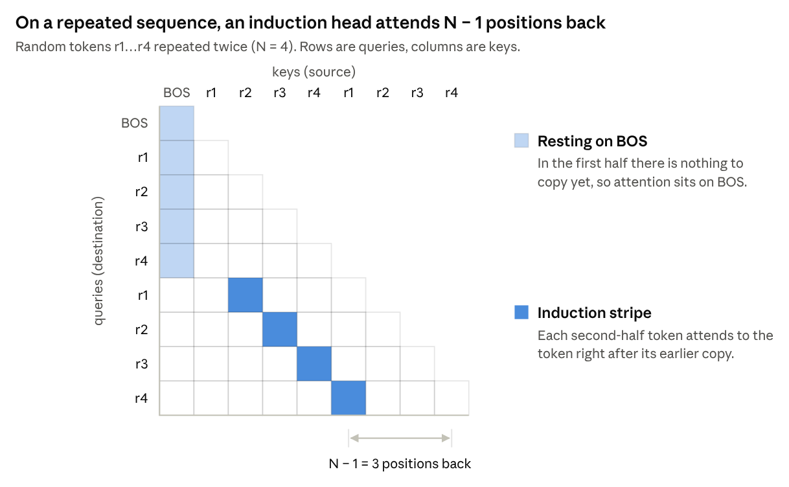
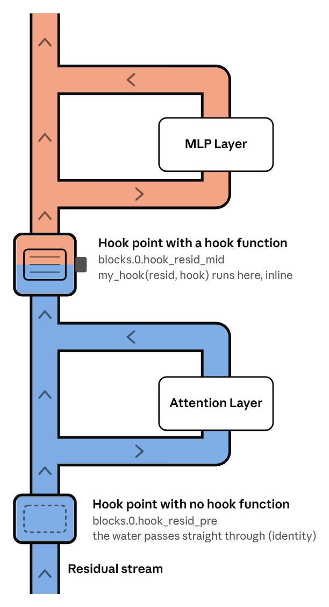

Use TransformerLens to inspect a trained transformer, find induction heads, and use hooks to test what they do.

## This week's exercises

All of Parts 1 and 3. For Part 2, we'll just do the setup that Part 3 needs (see below).

Total ~2.5 hours.

| Section | Exercise | Importance | Time |
| --- | --- | --- | --- |
| 1.2 Part 1 | Inspect your model | 3/5 | 5 min |
| 1.2 Part 1 | How many tokens does your model guess correctly? | 3/5 | 10 min |
| 1.2 Part 1 | Verify activations | 3/5 | 15 min |
| 1.2 Part 2 | Setup only (see below) | — | 10 min |
| 1.2 Part 2 | Visualise & inspect attention patterns (optional) | 3/5 | 10 min |
| 1.2 Part 3 | Calculate induction scores with hooks | 4/5 | 20 min |
| 1.2 Part 3 | Find induction heads in GPT2-small | 4/5 | 15 min |
| 1.2 Part 3 | Build logit attribution tool | 4/5 | 15 min |
| 1.2 Part 3 | Interpret logit attribution for induction heads | 4/5 | 15 min |
| 1.2 Part 3 | Induction head ablation | 4/5 | 30 min |
| 1.2 Part 3 | Mean ablation | 3/5 | 10 min |

Part 3 uses a good chunk of stuff from Part 2, so you'll need to do the following in order for Part 3 to work correctly:

1. Run the setup cells that build the `HookedTransformerConfig` and load the 2-layer attention-only model (`model`).
2. Read the explanations of induction heads and the repeated-token experiment. The notes below should cover most of this, too.
3. For `generate_repeated_tokens`, `run_and_cache_model_repeated_tokens`, and `get_log_probs`, just paste the solution into your notebook and run it (unless you want to write them yourself).
4. Run the cell that creates `rep_tokens` and `rep_cache`. Part 3 uses both.
5. Skip the detector exercises and the per-token loss plot.

## Background and Overview

**Mechanistic interpretability** (mech interp) is the attempt to reverse engineer neural networks to better understand how they work. Two words that will come up all the time:

- A **feature** is a property of the input that the model represents internally. Usually this is a direction (vector) in some activation space.
- A **circuit** is a group of model parts (heads, neurons, the weights between them) that work together to compute something. Below and in the exercise notebook, we explore one of the cleanest known circuits, the **induction circuit**.

**[TransformerLens](https://transformerlensorg.github.io/TransformerLens/)** is a Python library (created by Neel Nanda) for doing mech interp on transformer-based language models, and this week's exercises are centered around learning how to use it. There are a number of other libraries that do similar things (and that are maybe used more frequently today), and later in the program we'll see how various methods (SAEs, steering) can be run using any of them. That said, TransformerLens is the best place to start and is especially good for learning the underlying/shared thinking behind all of these libraries and methodologies.

The week's content has four parts:

1. **TransformerLens basics**: load a model, run it, and read its activations.
2. **Finding induction heads**: look at attention patterns and find heads that work together towards induction tasks.
3. **Hooks**: run functions inside the model's forward pass to measure and change things.
4. **Reverse-engineering the induction circuit**: use the weights to explain *how* two heads work together (optional, not covered this week).

## TransformerLens

### `HookedTransformer`

A `HookedTransformer` is just a transformer (like the ones we built last week) with a `HookPoint` attached to every internal activation. We'll get more into these later, but they're essentially identity functions wrapped around internal activations that provide **access points to our transformer's internals and allow us to manipulate these individual activations using hooks**.

Loading a pretrained model:

```python
from transformer_lens import HookedTransformer, utils

gpt2_small = HookedTransformer.from_pretrained("gpt2-small")
gpt2_small.cfg   # n_layers=12, n_heads=12, d_model=768, n_ctx=1024, ...
```

TransformerLens supports 40+ open models this way. In Part 2 you will build a tiny (2-layer, attention-only) toy model from a `HookedTransformerConfig` and load its weights from HuggingFace to analyze.

### Running the model

To run the model, you can give the model a string or a tensor of token IDs with shape `[batch, seq]`:

```python
# `model` is any HookedTransformer, e.g. gpt2_small from above
logits = model("I often wish I had a pet monkey", return_type="logits")  # [batch, seq, d_vocab]
loss   = model("I often wish I had a pet monkey", return_type="loss")    # scalar
```

`return_type` can also be `"both"` or `None`.

### Moving between text and tokens

```python
model.to_tokens(text)      # tensor of token IDs, shape [1, seq]
model.to_str_tokens(text)  # list of strings, one per token
model.to_string(tokens)    # back to text
```

One thing to note: by default, TransformerLens puts a **BOS token** (`<|endoftext|>`) at the start of every input. Many heads end up using this as a "resting place" when they have nothing useful to attend to (we will see this in the attention patterns). These helper functions can come in handy for debugging common positional/dimensionality errors.

### Parameters vs. activations

- **Parameters**, as we know, are the learned weights and are the same for every input during inference. TransformerLens gives us shortcuts to access them like `model.W_Q`, `model.W_K`.
- **Activations** are the values computed during one forward pass—for example, the residual stream, the queries and keys, or the attention patterns. They depend on the input and are gone after the pass, unless we explicitly save them. Attention patterns, for instance, are patterns of *activations* in an attention head, not parameters.

### `run_with_cache` and `ActivationCache`

An activation cache, as the name suggests, is just a cache of the model's activations! Very helpful for doing mech interp. To save them, just run the model with `run_with_cache`:

```python
logits, cache = model.run_with_cache(tokens)
```

`cache` is an `ActivationCache` that then is like a dictionary from hook names to tensors consisting of the activations. There are two ways to index it:

```python
cache["blocks.0.attn.hook_pattern"]   # full hook name
cache["pattern", 0]                   # shorthand: (short name, layer)

utils.get_act_name("pattern", 0)      # -> "blocks.0.attn.hook_pattern"
```

If you pass `remove_batch_dim=True` to `run_with_cache`, the batch dimension is removed from every tensor in the cache. This is convenient when you run one prompt. `cache.keys()` lists every hook name it holds.

### Hook point names

Hook names follow the pattern **`blocks.{layer}.{sublayer}.hook_{name}`**. Below are some of the main ones we'll use the most:

| Full name (layer 0) | Short name | What it is | Shape | Week 2 Math Notation |
| --- | --- | --- | --- | --- |
| `hook_embed` | `embed` | Token embeddings | `[batch, seq, d_model]` | $X_E$ |
| `hook_pos_embed` | `pos_embed` | Positional embeddings | `[batch, seq, d_model]` | $X_P$ |
| `blocks.0.hook_resid_pre` | `resid_pre` | Residual stream into the block | `[batch, seq, d_model]` | $X^{(l-1)}$ |
| `blocks.0.attn.hook_q` (also `_k`, `_v`) | `q`, `k`, `v` | Queries, keys, values per head | `[batch, seq, n_heads, d_head]` | $Q, K, V$ |
| `blocks.0.attn.hook_attn_scores` | `attn_scores` | Scores after scale and mask, before softmax | `[batch, n_heads, seqQ, seqK]` | $S$ |
| `blocks.0.attn.hook_pattern` | `pattern` | Attention probabilities | `[batch, n_heads, seqQ, seqK]` | $A$ |
| `blocks.0.attn.hook_z` | `z` | Weighted sum of values, per head | `[batch, seq, n_heads, d_head]` | $Z$ |
| `blocks.0.hook_attn_out` | `attn_out` | Attention output, summed over heads | `[batch, seq, d_model]` | $\text{Attn}^{(l)}(\cdot)$ |
| `blocks.0.hook_resid_mid` | `resid_mid` | Residual stream after attention, before MLP | `[batch, seq, d_model]` | $\tilde{X}^{(l)}$ |
| `blocks.0.mlp.hook_pre` / `hook_post` | `pre` / `post` | MLP neurons before / after GELU | `[batch, seq, d_mlp]` | $H$, $GELU(H)$ |
| `blocks.0.hook_mlp_out` | `mlp_out` | MLP output | `[batch, seq, d_model]` | |
| `blocks.0.hook_resid_post` | `resid_post` | Residual stream out of the block | `[batch, seq, d_model]` | $X^{(l)}$ |

Here is a useful diagram from ARENA of one attention-only block. Each box is an activation with its hook name, and the red text is its shape (without the batch dimension).



*Source: [ARENA 1.2](https://learn.arena.education/chapter1_transformer_interp/02_intro_mech_interp/1-transformerlens-introduction/). See also the [full block with MLP and LayerNorm](https://raw.githubusercontent.com/info-arena/ARENA_img/main/misc/full-merm.svg).*

## Looking at Attention Patterns

One of the easiest activations to interpret is the **attention pattern**. It tells us, for each head, which earlier tokens each token is attending to.

### Three simple head types

In the 2-layer model, many heads fall into one of three simple types. You can find each type by where its attention mass sits in the attention visualization matrix.



- **Current-token heads** attend mostly to the token itself (the main diagonal).
- **Previous-token heads** attend mostly to the token just before (one below the diagonal). These make sense because neighboring tokens share a lot of information.
- **First-token heads** attend mostly to the first token, BOS (the first column). Since attention scores are softmaxed row-wise, each row must add up to 1. What you'll find here (slight spoiler) is that when a head has "nothing to do" it still needs to put this attention mass somewhere, so it puts it in the "harmless" BOS token position.

## Induction Heads

### What they are

Text repeats itself a lot. Many things like names and phrases show up multiple times in the same document. If you read "Barack Obama" earlier in a story and now you see "Barack", a very good guess for the next token is "Obama".

This is what an **induction head** does! In a more general form:

> If the current token is **A**, and earlier in the context **A** was followed by **B**, then predict **B**.

We can write this as `[A][B] ... [A] -> [B]`. The head does it in three steps:

1. **Look back** for an earlier copy of the current token A.
2. **Attend** to the token just *after* that copy (B).
3. **Copy** B into the output, so the model predicts B.



Some terminological clarifications:

- An **induction head** is the head that does steps 2 and 3 (it attends to B and copies it).
- The **induction circuit** is the induction head plus a **previous-token head** in an earlier layer, which makes step 1 possible.

### Original findings

Induction heads were studied in depth by Anthropic in [In-context Learning and Induction Heads](https://transformer-circuits.pub/2022/in-context-learning-and-induction-heads/index.html) (Olsson et al., 2022). Some main findings:

- They show up in every model with two or more layers that they studied, from tiny toy models to large LLMs.
- They form suddenly during training (a **phase change**).
- At the same time, the model gets much better at **in-context learning**: its predictions improve for tokens later in the context. The paper argues induction heads are responsible for much of this.
- More general versions of the same idea ("fuzzy" induction) seem to help with things like translation and few-shot learning.

### Why not just one layer?

This is a pretty important intuition to build. First, we recall from week 2 that an attention head decides where to attend using the **query** from the current token and the **keys** from the earlier tokens. In layer 0, each token's residual stream only contains *its own* token and position.

But if the current token is A and our attention head wants to attend to B, there's a problem: B's residual stream only says "I am B, at position k," and nothing says "the token before me was A." So, in layer 0, A has no way to find B.

An induction circuit thus needs two layers:

1. In the first layer, a **previous-token head** at B's position can attend to the token before and write "the previous token was A" into B's residual stream.
2. In the second layer, the **induction head** at the second instance of token A can use a query like "I am A, find a token whose previous token was A." B's key can now match this and allow the head to attend to B and copy its value.

The intuition here is that there are a number of tasks like this that require a kind of sequential processing of heads working together across layers.

### The repeated-token experiment

To test for induction cleanly, the notebook uses a **sequence of random tokens, repeated twice**: `[BOS] r1 r2 ... rN r1 r2 ... rN`. In the first half, the tokens are random, so the model can't predict them and the loss is high. In the second half, every token has appeared before, so a model with induction heads can just copy, and the loss drops a lot. Since this input looks nothing like training data, doing well on it means the model is using a general copying algorithm.

Where does an induction head attend on this input? Each second-half token attends to the token right after its earlier copy, which is always N − 1 positions back. In the attention pattern, this shows up as a diagonal line N − 1 below the main diagonal, called the **induction stripe**.



A head's **induction score** is just its average attention on this stripe. In Part 3, you compute this score for every head in GPT-2 Small using hooks.

## Hooks

`run_with_cache` lets us *read* activations after the fact, but hooks let us then *intervene* on these activations during a forward pass.

### One way to think about hooks

(Credit to Claude for the original idea behind this metaphor)

We can think of a forward pass like a flow of water (information/representations) through piping (layers/components). Every `HookPoint` is like a short section of pipe with an empty slot to insert a filter that alters the composition of the water. The water always flows through it, and by default, the slot is empty, so the water passes straight through as if it isn't there (an identity function). But, we can also slot in a filter, aka plug a hook function into the `HookPoint`. With this, every drop of water then has to pass through that function on its way to the rest of the model.



### The hook function

```python
def my_hook(
    pattern: Float[Tensor, "batch n_heads seqQ seqK"],
    hook: HookPoint,
) -> Float[Tensor, "batch n_heads seqQ seqK"] | None:
    ...
```

- The **first argument** is the activation at that hook point.
- The **second argument** is the `HookPoint` object. The two attributes you will use most are `hook.name` (for example `"blocks.1.attn.hook_pattern"`) and `hook.layer()` (for example `1`).
- If you **return nothing**, the activation is unchanged.
- If you **return a tensor of the same shape**, it replaces the activation.

The type hints are not required, but they help a lot. Writing down expected shapes is also super helpful for keeping track of things and preventing mistakes.

### Running the model with hooks

```python
loss = model.run_with_hooks(
    tokens,
    return_type="loss",
    fwd_hooks=[("blocks.1.attn.hook_pattern", my_hook)],
)
```

- `fwd_hooks` is a list of `(name, function)` pairs, however many we want to attach.
- To attach the same hook function at every layer, you can pass a filter function in place of the name, like `lambda name: name.endswith("pattern")`.
- Hooks are removed at the end of `run_with_hooks`.

Hook functions take exactly two arguments. When you need more (for example, which head to ablate), use `functools.partial` to fix the extra arguments first:

```python
from functools import partial

def head_ablation_hook(z, hook, head_index):
    ...

hook_fn = partial(head_ablation_hook, head_index=4)   # now hook_fn(z, hook) works
```

### What you'll use hooks for in Part 3

- **Direct logit attribution.** The residual stream is a sum of what each component writes into it, and in the attention-only model the logits are a linear function of the final residual stream. So you can split the logit for the correct next token into one contribution per head and see which heads directly push the model toward the right answer. This only measures *direct* effects: a head can matter a lot by helping a later head while contributing little directly.
- **Ablation.** To ablate a component is to remove it and see what breaks. **Zero-ablation** sets one head's output (`z`) to zero. **Mean-ablation** replaces it with its average value instead, which keeps the model closer to the inputs it saw in training. If the loss on the repeated sequence goes up a lot, that head mattered for induction. Unlike attribution, ablation is causal: you change the model and measure what happens.

## Reverse-Engineering Induction Circuits

We're not going to cover part 4 this week for time-constraint reasons. It's definitely on the more difficult side of things, but if it's interesting to you and you have time, I'd highly recommend at least reading through the sections of the notebook!

## Further Resources

#### TransformerLens and Hooks

1. [ARENA 1.2: TransformerLens Introduction](https://learn.arena.education/chapter1_transformer_interp/02_intro_mech_interp/1-transformerlens-introduction/)
1. [ARENA Lecture: Introduction to Mechanistic Interpretability](https://www.youtube.com/watch?v=lfwT79Hgytc)
1. [TransformerLens Documentation](https://transformerlensorg.github.io/TransformerLens/)
1. [TransformerLens Main Demo](https://transformerlensorg.github.io/TransformerLens/generated/demos/Main_Demo.html)

#### Induction Heads and Circuits

1. [Induction Heads Illustrated](https://www.lesswrong.com/posts/TvrfY4c9eaGLeyDkE/induction-heads-illustrated)
1. [In-context Learning and Induction Heads](https://transformer-circuits.pub/2022/in-context-learning-and-induction-heads/index.html)
1. [A Mathematical Framework for Transformer Circuits](https://transformer-circuits.pub/2021/framework/index.html)
1. [A Walkthrough of A Mathematical Framework for Transformer Circuits](https://youtu.be/KV5gbOmHbjU?si=eK80cWcC-jgt2r0O)

#### Getting Into Mech Interp

1. [Neel Nanda's Mech Interp Explainer & Glossary](https://dynalist.io/d/n2ZWtnoYHrU1s4vnFSAQ519J#z=_Jzi6YHRHKP1JziwdE02qdYZ)
1. [Neel Nanda: Concrete Steps to Get Started in Transformer Mechanistic Interpretability](https://www.lesswrong.com/posts/9ezkEb9oGvEi6WoB3/concrete-steps-to-get-started-in-transformer-mechanistic)
1. [Neel Nanda: Mechanistic Interpretability Quickstart Guide](https://neelnanda.io/mechanistic-interpretability/quickstart)
