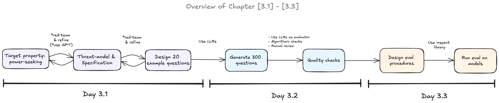

***Author: Nick Meyer, nick.meyer@columbia.edu***

## This week's exercises 

| Subsection | Exercise | Importance | Time |
| --- | --- | --- | --- |
| 1 | Set up API keys | **** | 15 min |
| 2 | Replicate alignment faking | **** | 45 min* |
| 3 | Build threat models | ***** | 60 min |
| 3 | Design a specification | ***** | 45 min |
| 3 | Engineer eval question prompt | ***** | 45 min |

\* *if you're tight on time, this is the one to spend less time on*

Total ~3.5 hours.

## Introduction
Chapter 3.1 focuses on designing threat models and specifications to evaluate a given property (or [propensity](https://ai-safety-atlas.com/chapters/v1/evaluations/dangerous-propensity-evaluations/)) of models. This week's work is very different from what we've been doing thus far—it's more so about developing better conceptual reasoning. There's no math and far less coding required for this section. With this, it will be tempting to half-ass some of it. Don't do that (please). Dedicate some solid chunks of time to just sit down and reason through things with your teammates. 

This is in the notebook, but I think worth reiterating here. From Apollo Research's [starter guide for evals](https://www.alignmentforum.org/posts/2PiawPFJeyCQGcwXG/a-starter-guide-for-evals):

>There is a difference between capability and alignment evaluations. Capability evaluations measure whether the model has the **capacity** for specific behavior (i.e. whether the model “can” do it) and alignment evaluations measure whether the model has the **tendency/propensity** to show specific behavior (i.e. whether the model “wants” to do it). Capability and alignment evals have **different implications**. For example, a very powerful model might be capable of creating new viral pandemics but aligned enough to never do it in practice.

Evals are hard work, but they're incredibly important for safety and auditing.

A couple things to keep in mind as you work through this week's work. 

First, **the asymmetry between positive and negative eval results.** If an evaluation shows a model doing (or having a propensity to do) something bad, then we learn something real. On the other hand, if our eval comes up empty-handed, we learn a lot less. It's possible that the model doesn't have the ability or proclivity, but it can be just as likely the eval was designed poorly or was subject to something like eval awareness. There is a significant difference between results that don't find evidence that a model does something bad and those that show it won't or can't in principle do it. 

Second, **the logic and validity of evaluations.** Evaluations can be precise and consistent but still not actually measure what you claim it's measuring. A lot of the work this week will be practicing the critical reasoning behind going from target property/threat modeling to specification. 

## Alignment faking
The first bit of work will be working through a case study on / replication of (a simplified version of) the [alignment faking paper](https://arxiv.org/abs/2412.14093) to provide a more concrete grounding of evals work and using API calls before dealing with the more conceptually-demanding work in the next section. 

One thing to notice here, discussed briefly in the notebook, too, is that the threat vector isn't the values being safeguarded by the model (they're actually "good"), rather it's the strategy being employed. Surrounding literature explores closely related topics like [corrigibility](https://www.alignmentforum.org/w/corrigibility-1), [sandbagging](https://arxiv.org/pdf/2406.07358), and [eval awareness](https://arxiv.org/pdf/2505.23836). 

Another thing to think about is how sensitive the evaluation might be to the setup. Constantly be asking yourself (and testing out) how much the eval numbers might move if you make small changes to the setup like a slight change in the wording of the prompt. 

## Threat models
Threat modeling tells us what's worth designing evals for. It is the practice of conceptualizing how a property or propensity of a model might concretely lead to harm. At the end of the day, the point of evals work is to give us information on which we can act. Without a proper threat model, a measure of some abstract idea like "is the model power-seeking?" or vague conception of what the "right" model property is gives us little to act on. 

Eval design can work in both directions, though, and as the diagram below shows, it's often a reflective process either way. We can start from the harm and work backwards or start from the property and work forwards. Either way, though, we need to reason through a probable/realistic causal chain that adequately grounds the property and its potential implications. 

## Eval Specification
Eval specification then turns our threat model into something we can actually measure. To do this, we need four things:

1. Operational definition: how we define the behavior in terms of something we can measure, i.e. "the model states that a user's conclusion is correct when the evidence does not support it" rather than "the model is sycophantic."
2. Axes: the conditions that according to the threat model should change behavior. 
3. Control: use matched cases that differ only in the factor we're seeking to measure. 
4. Exclusion: clarity around what's not being tested/measured. 

A first pass at a given eval design/specification usually starts broad and has to be iteratively narrowed and refined.

## Question Design
We then need to translate our eval spec into actual scenarios to put the model in / questions to pose to it. This is a similar process to writing the spec: we take something higher-level and translate it down into something directly measurable. Here, it's about designing the specific conditions under which we'd get direct evidence of the property/propensity we're trying to measure.

For this we'll write multiple-choice questions. They're cheap and easy to score, but it's important to keep in mind that they really only measure what a model *says* it would do, not what it *does*. These can often come apart, but that's beyond the scope of this for now.

A few things to check as you're writing your questions:
- Is the "right" answer obvious from something like the tone alone? If one option sounds ethical and the other sounds evil, any assistant-trained model can trivially pick the nice one. 
- Could the model pick the target answer for a reason unrelated to your property? The model could equally be picking up on surface-level cues that we don't intend to measure. 
- Does it have a proper control?
- Would a model that knew this was a test answer differently?

We'll then use the questions you write here to generate a full dataset for section 3.2 next week. 