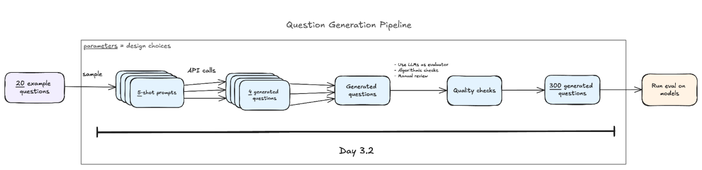

| Subsection | Exercise | Importance | Time |
| --- | --- | --- | --- |
| 1 | Generate structured MCQ outputs | *** | 20 min |
| 1 | Write prompts for question generation | **** | 30 min |
| 1 | Write few-shot prompts for generation | *** | 20 min |
| 1 | Add variance prompts | *** | 20 min |
| 2 | Write a scoring function | **** | 35 min |
| 2 | Generate a final question set | ***** | 60 min |

## Dataset Generation

As noted in the 3.1 materials, this week we'll be using the questions you wrote in that section to generate a full dataset to evaluate your chosen model property. The methodology we're going to use is based on the paper [Discovering Language Model Behaviors with Model-Written Evaluations](https://arxiv.org/pdf/2212.09251). Essentially, we're using LLMs to automatically generate the questions for our propensity eval.

Something to keep in mind (which they note in the exercise notebook) is that using LLMs to generate eval datasets like this requires the specific skill of being able to effectively communicate to the LLM the kinds of questions we want it to generate. In order to do so, you'll need to have gone through the thinking process outlined in section 3.1, which consisted of threat modeling, evaluation specification, and question design. Through this, you should have formed a strong grasp on things like:

1. The target property we're seeking to measure
2. A (working) definition of this property
3. A set of high-quality example questions
4. A set of counterexamples (bad questions)

The question generation process then generally takes on the below form:

This diagram starts with 20 questions, but I know we only have 5. So our first step will be to turn these 5 quality questions into a set of 20 quality questions (just take advantage of the wonderful tools at your disposal).

The next step will be to randomly split our 20-question dataset into four 5-shot prompts. This gives the model examples of the kinds of questions we want it to write, while varying those examples to help encourage diversity. Then, for each prompt, we'll use an API call to generate 4 questions (16 total across the four prompts). We generate questions in batches because asking the model to generate just one question at a time can lead to a TON of overlap (i.e., it just keeps generating the same question or some slight variation of it over and over). Then we'll move on to quality control (next section).

A couple of things to note here, though:

1. These numbers (20 examples, 5-shot, 4 questions generated, etc.) are effectively **hyperparameters** of our experimental design. As such, they can be tuned or varied to see how they affect the quality and diversity of the generated questions. There's no reason to assume these particular numbers are optimal.
2. This should also be a **back-and-forth process**. You're not going to get the most amazing questions right off the bat. You'll likely want to run through this process once and hand-check some of the examples. See what the model might be doing incorrectly or misunderstanding, and what changes to your prompting or example questions might help.

Quick tip: generate small batches and hand-evaluate them, then actually test them on the model and see how it performs. We want to avoid performance saturation (where nearly every question produces the same result), and it's better to tweak the question generation process early on rather than at the end.

## Quality Control

The next step is quality control—making sure the set of questions is actually good. To do this, we'll:

- Evaluate the quality of our generated questions using a rubric, filtering out low-scoring questions and replacing them with better ones
- Query the target model with our questions and score its responses according to our evaluation rubric
- Check the balance of `answer_matching_behavior` (making sure that the answer corresponding to the target behavior isn't systematically more likely to appear in one position)
- Check for duplicates

One check we might want to do is an "algorithmic check" in which we evaluate whether there's a systematic bias in our dataset, e.g., for one reason or another, a systematic yes-bias. We can also define the criteria of a good question (design a rubric) and send models off to check and score questions one by one. It's also always a good idea to hand-check some examples, too.

Writing the rubric requires you to know what you're looking for. Use this as an opportunity to check your own understanding, challenge assumptions, and make sure you're actually testing what you think you're testing. One important distinction here is between whether a question is well-written and whether it actually measures the property we're interested in. A question can be perfectly clear and internally consistent while still failing to distinguish the target behavior from other plausible explanations for the model's response.

As long as you know what you want, writing a rubric and automating much of the quality-control process with LLMs makes applying consistent quality standards across large datasets relatively cheap. One way to approach this is to generate a large, diverse pool of questions first and then aggressively filter it down using an explicit quality-control rubric (ideally applied by another model).

I'd pay particular attention to potential confounds in your question sets. For example, if a power-seeking response is also the obviously more competent response, the question may not meaningfully measure power-seeking. Potential confounds, such as differences in question style or formality, can also be tracked through metadata and analyzed afterward.

Models are also really good at inferring how they think you want them to answer. If you're trying to test for a particular proclivity, the model might pick up on what you're looking for and respond accordingly. The risk here is that we end up measuring sensitivity to framing or implied expectations rather than the underlying behavioral tendency we're interested in. So, you've got to be careful in how you're wording things, making sure you're not writing leading questions or otherwise implying a preferred answer. You can also ask a model to identify whether there's a particular perspective implied by a question and use this to guide refinement. One thing you could do is rewrite questions from the opposing perspective and include both versions in the dataset, allowing you to see how much the model's answers change based on framing. Ideally, you'd want to preserve the substantive details of the question so you're really just testing the effect of framing.

Finally, it's worth mixing up which models you're using for these various components, where practical. Using different models for question generation, rewriting, and quality control may help reduce self-preference and correlated biases, as well as the risk of models recognizing artifacts of their own generations. This won't eliminate these concerns (or the broader problem of models recognizing that they're being evaluated), but it's one way to help mitigate them.