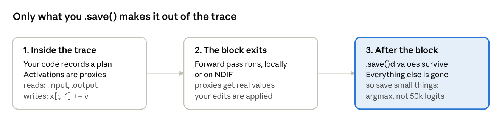
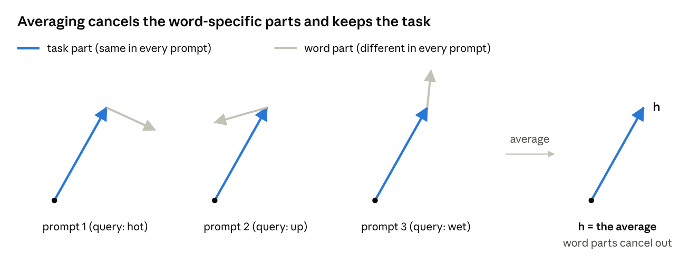
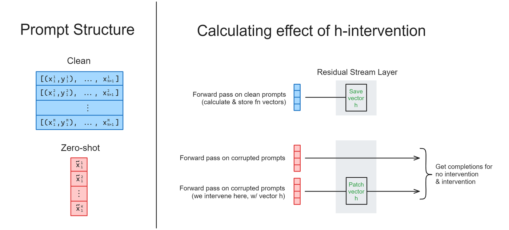
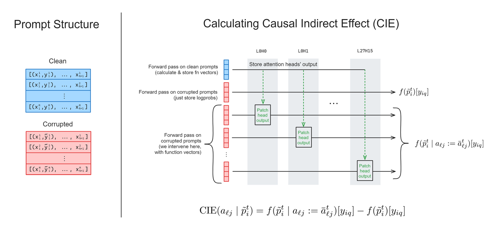
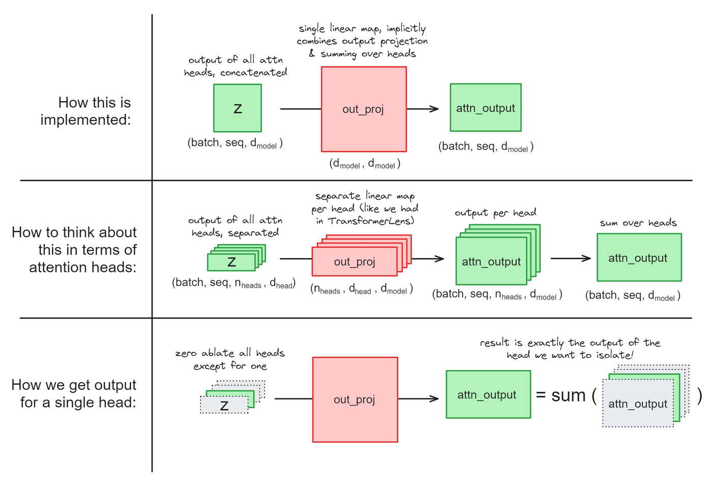
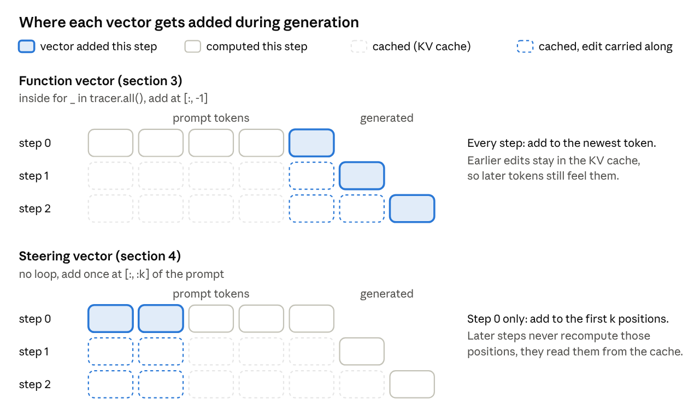

***Author: Rachael Chew, ryc2126@columbia.edu***

## This week's exercises

| Subsection | Exercise | Importance | Time |
| --- | --- | --- | --- |
| 1 | Visualize attention heads | ★★★ | 10 min |
| 2 | Forward pass on antonym dataset (`calculate_h`) | ★★★ | 15 min |
| 2 | Intervene with h (`intervene_with_h`) | ★★★★ | 15 min |
| 2 | Combine the last two functions (`calculate_h_and_intervene`) | ★★★ | 15 min |
| 3 | `calculate_fn_vectors_and_intervene` | ★★★★★ | 45 min |
| 3 | Calculate the function vector (`calculate_fn_vector`) | ★★★ | 25 min |
| 3 | Intervene with function vector, multi-token generation | ★★★★ | 20 min |
| 4 | Replicate the steering vector results (`calculate_and_apply_steering_vector`) | ★★★★ | 40 min |

**If you have extra time:** do "Compute change in accuracy" (15 min), then "Generalize results to another task."

The head-patching exercise is slow (one forward pass per head). If it drags, just run layer 8; nothing after it depends on it.

As always, if you're going past the time estimate on an exercise, have someone in your group peek at the solution or ask an LLM for a hint.

## Background and Overview

The big question this week: **can we change a model's behavior by adding a vector we found with plain forward passes?**

Why would that work? The residual stream is a running sum: every head and MLP reads from it and writes back to it (week 2). If the model represents a concept or task as a *direction* in that space (the linear representation hypothesis), adding that direction should make every later layer "see" it, even if the prompt never mentioned it. We test this with two kinds of vectors:

- **Function vectors** ([Todd et al., 2023](https://functions.baulab.info/)) encode a *task*, like "give the antonym". They're built from a few attention heads' outputs on in-context learning (ICL) prompts. Add one to a zero-shot prompt and the model does the task.
- **Steering vectors** ([Turner et al., 2023](https://www.lesswrong.com/posts/5spBue2z2tw4JuDCx/steering-gpt-2-xl-by-adding-an-activation-vector)) encode a *behavior or topic*, like "loving" or "talks about weddings". They're the difference between two contrasting prompts' activations.

We'll use **nnsight**, which handles models too big for TransformerLens (GPT-J-6B this week) and can run them remotely.

**Why this matters for safety.** Steering gives control without retraining: [CAA](https://arxiv.org/abs/2312.06681) dials sycophancy and power-seeking up or down in Llama 2, and [Arditi et al.](https://arxiv.org/abs/2406.11717) found refusal is a single direction you can remove or add. It's also a causal test of understanding. A probe shows a concept is *readable*; steering shows the model *uses* it.

One caveat: a vector that works doesn't prove you found *the* representation the model uses, only one that pushes the right way. And pushing too hard breaks coherence.

## nnsight

nnsight lets you read and edit any activation in a HuggingFace model. The catch: code inside a trace block doesn't run when you think it does.

### Describe first, run later

```python
with model.trace(prompt, remote=REMOTE):
    hidden = model.transformer.h[-1].output[0].save()  # [batch, seq, d_model]
    logits = model.lm_head.output[0, -1].save()        # [d_vocab]
```

Inside the `with` block, `model.transformer.h[-1].output[0]` isn't a tensor yet. It's a **proxy**, a placeholder for whatever the value will be when the forward pass gets there. Operations on proxies give more proxies, so the block just records a plan. When it exits, nnsight runs the forward pass, carries out the plan, and throws away everything you didn't `.save()`.



Make sure you save anything you need after the block. Things you only use inside it (like a vector you're about to patch in) don't need saving.

### Finding activations: module paths, not hook names

nnsight wraps the raw HuggingFace model, so instead of hook names you navigate its module tree (`print(model)` shows it). Every module has `.output` (what its forward returns) and `.input` (its first argument).

| What you want | TransformerLens (week 4) | nnsight on GPT-J |
| --- | --- | --- |
| Residual stream into block l | `cache["resid_pre", l]` | `model.transformer.h[l].input` |
| Residual stream out of block l | `cache["resid_post", l]` | `model.transformer.h[l].output[0]` |
| Per-head outputs z | `cache["z", l]` | `model.transformer.h[l].attn.out_proj.input` (heads concatenated, so you split them yourself) |
| Attention pattern | `cache["pattern", l]` | `model.transformer.h[l].attn.attn_dropout.input` |
| Logits | the model's return value | `model.lm_head.output` |
| Intervening | write a hook function, call `run_with_hooks` | just assign inside the trace: `x[:, -1] += v` |

GPT-J blocks return a tuple (hidden states, attention weights), hence `.output[0]`.

### Multiple invokes: several batches, one forward pass

```python
with model.trace(remote=REMOTE) as tracer:
    with tracer.invoke(clean_prompts):
        clean_acts = model.transformer.h[10].output[0]       # proxy, no .save() needed

    with tracer.invoke(corrupted_prompts):
        model.transformer.h[10].output[0][:] = clean_acts   # patch clean into corrupted
        logits = model.lm_head.output[:, -1].save()
```

Each `tracer.invoke` adds its prompts to the same batch, and a proxy from one invoke can be used in a later one. That's the pattern for most of this week: compute something from one set of prompts, patch it into another, all in one pass.

One rule: a value has to exist before you use it. Reading layer 10 and patching into layer 10 or later works. Patching into layer 9 can't, since layer 9 already ran. This can fail silently.

## Task-encoding hidden states (the h-vector)

The residual stream at the last token of an ICL prompt holds a vector that encodes the task, and you can transplant it into a prompt with no examples.

### The setup: in-context learning

What the model sees:

```
Q: hot
A: cold

Q: up
A: down

Q: wet
A:
```

The answer is "dry". Nothing in the weights says "do antonyms now". The task only exists in the context, so the model has to work it out and carry it to the last position, where the prediction happens.

### Building h: average away everything but the task

Take the residual stream at a middle layer, at the last position. For one prompt, it mixes the query word ("wet"), the Q/A format, position, and hopefully the task. Average it over many ICL prompts with different words:


$$h = \frac{1}{N} \sum_{i=1}^{N} x^{(12)}_{i,\ \text{last}} \in \mathbb{R}^{d_{model}}$$

The word-specific parts point in different directions from prompt to prompt, so they mostly cancel. The task is the same in every prompt, so it survives.




### Using h: patch it into a zero-shot prompt

Now add h to a zero-shot prompt (`"Q: wet\nA:"`) at the same layer and position.

- **Without h:** \~0% correct. GPT-J mostly copies the word back (`wet -> wet`).
- **With h:** \~25 to 50% correct. One averaged vector told the model what task to do.



*Source: ARENA 1.3.2. The bottom two rows are the zero-shot prompts (the diagram labels them corrupted).*

**Why the last position?** It's where the prediction happens, so it's the one position that needs to know both "which word" and "which task". Earlier positions are in the middle of examples.

Even when the top prediction doesn't change, the correct answer's log-prob goes up in nearly every example. That's why section 3 measures logprobs, not accuracy.

## Function vectors

h was the *whole* residual stream: task plus junk. Function vectors keep only the outputs of the few attention heads that carry the task.

### Why look at attention heads?

Something has to move task info from the examples to the last position, and moving info between positions is exactly what attention does (MLPs work on each position separately). Hypothesis: a few heads at the last position read the examples and write "the task is antonyms" into the residual stream.

### Finding them: patch one head at a time

Like week 4's ablations, but more surgical. Two datasets:

- **Clean prompts:** normal ICL prompts.
- **Corrupted prompts:** the same prompts, but each example's answer is swapped for a random word (`hot -> private`). Same format, length and final query; only the task signal is gone.

Then, for every head:

1. On the clean prompts, record that head's output at the last position, averaged over prompts.
2. Run the corrupted prompts, but overwrite that head's output at the last position with this clean average.
3. Measure how much the log-prob of the correct answer goes up, compared to the corrupted run with no patch.

Average over prompts to get each head's **average indirect effect (AIE)**, the heatmap you plot. Most heads do nothing. A handful in the middle layers light up.



*Source: ARENA 1.3.2. One clean run, one plain corrupted run, then one patched corrupted run per head.*

Two design choices worth understanding:

- **Why corrupted, not zero-shot?** Corrupted prompts match the clean ones in everything but the task signal (length, positions, format), so any recovered logprob has to come from task info in that head.
- **Why patch the mean over clean prompts?** Same reason as h: we want what's shared (the task), not one prompt's words.

### The out\_proj problem: getting one head's output

In TransformerLens, z had a head dimension. In GPT-J, the heads' z vectors are concatenated into one vector, and one linear layer, `out_proj`, maps that to the residual stream. That single matmul both projects each head and sums over heads.

Why is that the same thing? Split W\_O into row blocks, one per head. A concatenated vector times a stacked matrix is the sum of the block products:

$$\text{attn\_out} = \begin{bmatrix} z_0 & z_1 & \cdots & z_{15} \end{bmatrix} \begin{bmatrix} W_O^{0} \\ W_O^{1} \\ \vdots \\ W_O^{15} \end{bmatrix} = \sum_{j=0}^{15} z_j W_O^{j}$$

(This is the "heads are independent and additive" result from *A Mathematical Framework*.) Two consequences:

- **To patch a head, edit z** (the input to `out_proj`), reshaped so the heads are separate. The output of `out_proj` is already summed, so you can't do it there.
- **To get one head's output in the residual stream**, you'd compute z\_j W\_O^j, but nnsight won't let you touch weights inside a trace. Instead, zero every *other* head in z and call `out_proj`. The zeroed blocks add nothing, so you get exactly the heads you kept. (This works because `out_proj` has no bias.)



*Source: ARENA 1.3.2. Top row is what the code does, middle row is how to think about it, bottom row is the zero-ablation trick.*

### Building and using the function vector

The function vector is the sum of the top heads' mean outputs, mapped into the residual stream with the zero-ablation trick above. One vector, the size of the residual stream.

Add it to the residual stream at the last position, and it works even outside the Q/A format: `The word "light" means` gets completed by defining the word as its opposite.

### Multi-token generation

For generation, the intervention has to run on every generation step (`tracer.all()` in nnsight).

The key is the **KV cache**. Step 0 processes the whole prompt; each later step processes only the new token and reads older positions' keys and values from the cache. So inside the loop, `[:, -1]` is always the newest token, and earlier edits persist through the cache. Code outside the loop only runs on step 0.



*Bottom panel: steering vectors (section 4) are added once, at the start of the prompt, and the cache carries the edit forward.*

## Steering vectors (activation addition)

Turner et al. subtract the activations of one prompt ("Hate") from another ("Love") and add the difference to the start of a new prompt. The completions change tone or topic. No head search, just subtraction.

### The recipe

1. Pick a contrast pair, like "Love" vs "Hate", plus a layer and a coefficient.
2. Run both prompts and grab the residual stream going *into* that layer at every position.
3. The steering vector is coefficient × (Love acts − Hate acts): one vector *per position*.
4. Add it to the first positions of your prompt (`"I hate you because"`), once, then generate.

How the positions line up:

| Position | 0 | 1 | 2 | 3 | 4 |
| --- | --- | --- | --- | --- | --- |
| Prompt | `<\|endoftext\|>` | `I` | `  hate ` | `  you ` | `  because ` |
| +8 × | `<\|endoftext\|>` | `Love` | ` ` |  |  |
| −8 × | `<\|endoftext\|>` | `H` | `ate` |  |  |

### Why subtract?

On its own, the activations of `"Love "` are mostly *not* about love. They carry position info, "start of document", the BOS token (week 4's resting place) and so on. Subtracting a matched prompt cancels what the two share and leaves (roughly) the love-vs-hate direction.

Same move as h: there you cancelled word-specific stuff by **averaging**; here you cancel shared stuff by **subtracting**. [CAA](https://arxiv.org/abs/2312.06681) does both, averaging differences over hundreds of contrast pairs, which is much more robust.

### Gotchas

- **Contrast prompts need the same token count**, since you subtract position by position. Pad the shorter one with spaces.
- **Batches are left-padded**, so slice the contrast prompts' activations from the right.
- **Sampling is random**, so compare several completions before deciding.
- **Start with the weddings example.** It's far more robust than Love/Hate.

Tune the coefficient and layer: too small does nothing, too big gives gibberish.

## Further Resources

**Function vectors**

- [Function Vectors in Large Language Models](https://arxiv.org/abs/2310.15213) (Todd et al., ICLR 2024)
- [Function vectors project page, code and data](https://functions.baulab.info/)

**Steering**

- [Steering GPT-2-XL by adding an activation vector](https://www.lesswrong.com/posts/5spBue2z2tw4JuDCx/steering-gpt-2-xl-by-adding-an-activation-vector) (the post section 4 replicates)
- [Activation Addition: Steering Language Models Without Optimization](https://arxiv.org/abs/2308.10248) (the full paper version)
- [Steering Llama 2 via Contrastive Activation Addition](https://arxiv.org/abs/2312.06681) and its [LessWrong post](https://www.lesswrong.com/posts/v7f8ayBxLhmMFRzpa/steering-llama-2-with-contrastive-activation-additions)
- [Inference-Time Intervention: Eliciting Truthful Answers from a Language Model](https://arxiv.org/abs/2306.03341)
- [Refusal in Language Models Is Mediated by a Single Direction](https://arxiv.org/abs/2406.11717)
- [Red-teaming language models via activation engineering](https://www.alignmentforum.org/posts/iHmsJdxgMEWmAfNne/red-teaming-language-models-via-activation-engineering)

**nnsight and background**

- [nnsight docs](https://nnsight.net/) and [remote execution guide](https://nnsight.net/notebooks/features/remote_execution/)
- [NDIF model status page](https://nnsight.net/status/)
- [A Mathematical Framework for Transformer Circuits](https://transformer-circuits.pub/2021/framework/index.html) (heads are independent and additive)
- [Transformer Inference Arithmetic](https://kipp.ly/transformer-inference-arithmetic/) (more on KV caching)